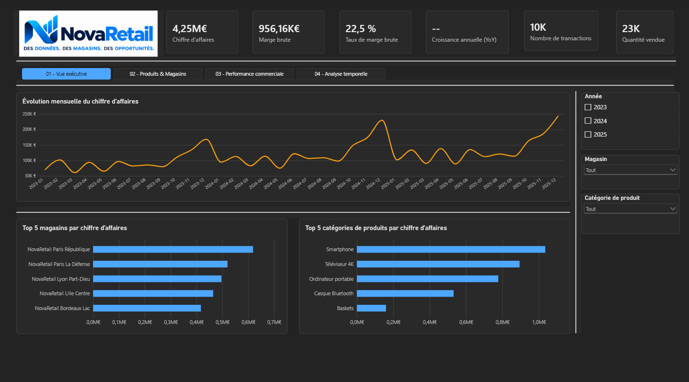
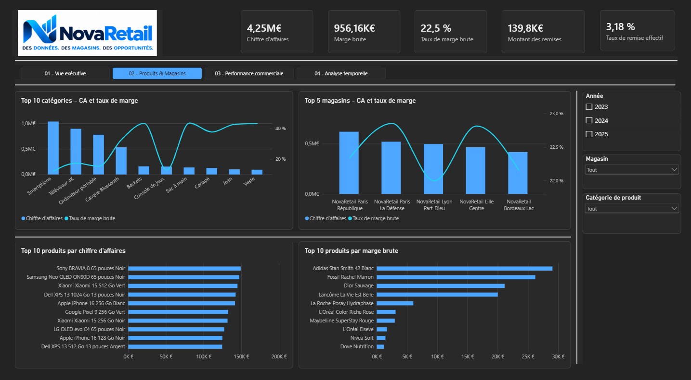
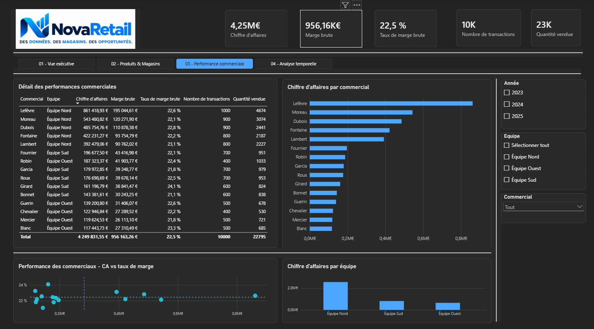
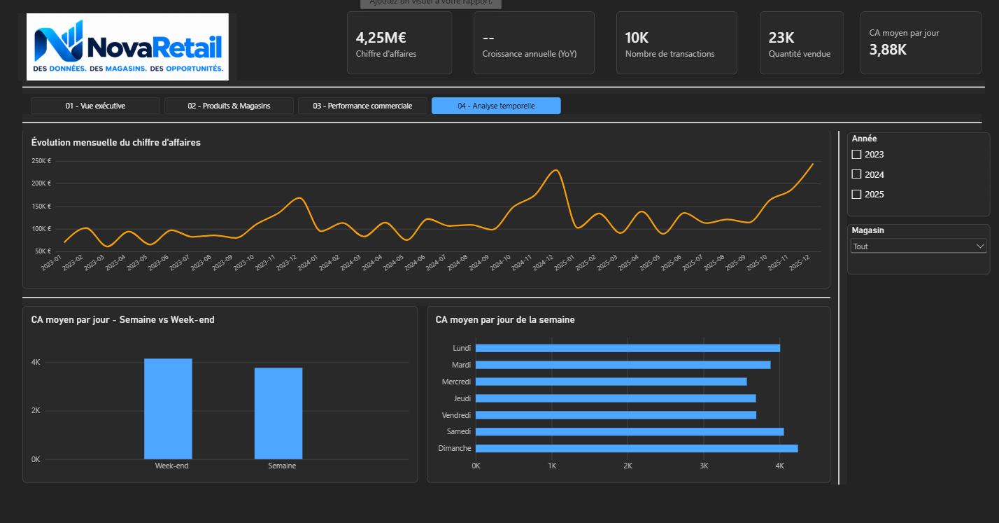

# NovaRetail BI

## Présentation

NovaRetail BI est un projet de Business Intelligence reproduisant un cas d'étude professionnel.

L'objectif est de concevoir une solution décisionnelle complète permettant à une direction commerciale de piloter son activité grâce à des indicateurs clés et à un tableau de bord Power BI.

Ce projet est développé dans le cadre de mon portfolio Data Analytics afin de mettre en pratique les différentes étapes d'un projet décisionnel, depuis l'analyse du besoin métier jusqu'à la réalisation du tableau de bord final.

---

## Contexte métier

**NovaRetail** est une entreprise fictive spécialisée dans la distribution de produits.

La direction commerciale souhaite disposer d'une solution décisionnelle permettant de suivre les performances de l'entreprise, d'analyser les ventes et de faciliter la prise de décision.

Le projet vise notamment à répondre à des questions telles que :

- Comment évoluent le chiffre d'affaires et la marge dans le temps ?
- Quels magasins génèrent le plus de chiffre d'affaires ?
- Quels produits et types de produits contribuent le plus aux ventes et à la marge ?
- Comment les performances diffèrent-elles entre les magasins ?
- Quels commerciaux et quelles équipes commerciales génèrent le plus d'activité ?
- Les performances diffèrent-elles entre la semaine et le week-end ?
- Comment évolue le chiffre d'affaires d'une année à l'autre ?

---

## Objectif du projet

L'objectif de ce projet est de reproduire les différentes étapes d'un projet BI complet, depuis l'analyse du besoin métier jusqu'à la réalisation d'un tableau de bord décisionnel.

Le projet couvre notamment :

- l'analyse du besoin métier ;
- la définition des indicateurs clés de performance (KPI) ;
- la conception d'un modèle dimensionnel en étoile ;
- l'implémentation du modèle dans PostgreSQL ;
- la génération d'un jeu de données cohérent pour l'analyse ;
- la mise en place de contrôles de qualité des données ;
- l'analyse métier avec SQL ;
- la préparation et la modélisation des données dans Power BI ;
- la création de mesures DAX ;
- la conception d'un tableau de bord interactif ;
- l'interprétation des résultats et la formulation de recommandations métier.

---

## Architecture des données

Le modèle repose sur une architecture dimensionnelle en étoile composée d'une table de faits centrale et de cinq dimensions.

### Table de faits

- `fact_vente`

### Dimensions

- `dim_date`
- `dim_produit`
- `dim_client`
- `dim_magasin`
- `dim_commercial`

La granularité de `fact_vente` correspond à **un produit vendu dans une transaction**.

Une transaction identifiée par `code_vente` peut donc comporter plusieurs lignes de vente.

Les principaux faits stockés sont :

- la quantité vendue ;
- le prix unitaire ;
- le coût unitaire ;
- le taux de remise.

Les indicateurs analytiques tels que le chiffre d'affaires et la marge sont calculés à partir de ces données atomiques.

---

## Implémentation PostgreSQL

La base PostgreSQL contient :

- 72 produits ;
- 200 clients ;
- 10 magasins ;
- 15 commerciaux ;
- 10 000 transactions ;
- 16 500 lignes de vente ;
- une dimension Date couvrant la période 2023 à 2025.

Des contraintes d'intégrité et des contrôles qualité permettent de vérifier la cohérence du jeu de données avant son exploitation analytique.

La documentation détaillée de cette phase est disponible dans :

`docs/04_PostgreSQL_Implementation.md`

---

## Analyses SQL

Les analyses métier sont regroupées dans `database/queries.sql`.

Elles couvrent :

1. la performance commerciale globale ;
2. la performance annuelle ;
3. l'évolution mensuelle des ventes ;
4. la performance des magasins ;
5. la performance des produits ;
6. la performance par type de produit ;
7. la performance des commerciaux ;
8. la performance des équipes commerciales ;
9. la performance par magasin et type de produit ;
10. la comparaison entre semaine et week-end ;
11. la croissance annuelle du chiffre d'affaires.

Les contrôles de qualité sont regroupés dans `database/quality_checks.sql`.

---

## Résultats clés

L'analyse des ventes sur la période 2023–2025 met notamment en évidence :

- **4,25 M€ de chiffre d'affaires** pour **10 000 transactions** et **22 795 unités vendues** ;
- environ **956 K€ de marge brute**, soit un **taux de marge brute global de 22,5 %** ;
- une croissance du chiffre d'affaires de **27,40 % en 2024**, puis de **11,06 % en 2025** ;
- des profils produits différents entre contribution au chiffre d'affaires et rentabilité relative ;
- une forte concentration de l'activité commerciale au sein de l'équipe Nord ;
- un chiffre d'affaires moyen par jour environ **10 % plus élevé le week-end qu'en semaine**.

L'analyse détaillée, les interprétations et les recommandations associées sont disponibles dans `docs/07_Business_Insights.md`.

---

## Aperçu du dashboard

Le rapport Power BI est organisé en quatre vues analytiques :

1. **Vue exécutive** — synthèse des principaux KPI et tendances ;
2. **Produits & Magasins** — analyse du chiffre d'affaires, de la marge et des performances produits et magasins ;
3. **Performance commerciale** — analyse des commerciaux et des équipes ;
4. **Analyse temporelle** — évolution des performances et comparaison des périodes.

### Vue exécutive



### Autres vues du rapport

#### Produits & Magasins



#### Performance commerciale



#### Analyse temporelle



La conception détaillée du rapport et les choix analytiques sont documentés dans `docs/06_Dashboard_Design.md`.

---

## Structure du projet

```text
NovaRetail-BI/
│
├── README.md
│
├── docs/
│   ├── 01_Kickoff.md
│   ├── 02_Business_Requirements.md
│   ├── 03_Design_Review.md
│   ├── 04_PostgreSQL_Implementation.md
│   ├── 05_PowerBI_Model.md
│   ├── 06_Dashboard_Design.md
│   ├── 07_Business_Insights.md
│   └── images/
│       ├── data_model_v1.png
│       ├── data_model_v2.png
│       ├── data_model_v3.png
│       ├── dashboard_executive_overview.png
│       ├── dashboard_products_stores.png
│       ├── dashboard_sales_performance.png
│       └── dashboard_time_analysis.png
│
├── database/
│   ├── schema.sql
│   ├── seed.sql
│   ├── quality_checks.sql
│   ├── queries.sql
│   └── README.md
│
└── powerbi/
```

---

## Technologies utilisées

- PostgreSQL
- SQL
- Power BI
- Power Query
- DAX
- Git

---

## État d'avancement

| Étape                                    | Statut |
| ----------------------------------------- | ------ |
| Kick-off                                  | ✅     |
| Analyse du besoin métier                 | ✅     |
| Définition des KPI                       | ✅     |
| Conception du modèle de données         | ✅     |
| Revue de conception                       | ✅     |
| Implémentation PostgreSQL                | ✅     |
| Génération des données                 | ✅     |
| Contrôles qualité des données          | ✅     |
| Analyse SQL                               | ✅     |
| Modélisation Power BI                    | ✅     |
| Mesures DAX                               | ✅     |
| Tableau de bord Power BI                  | ✅     |
| Analyse des résultats et recommandations | ✅     |

---

## Documentation

La documentation du projet suit les différentes étapes de sa réalisation :

- `docs/01_Kickoff.md` - cadrage initial du projet ;
- `docs/02_Business_Requirements.md` - besoins métier et définition des KPI ;
- `docs/03_Design_Review.md` - évolution et validation du modèle de données ;
- `docs/04_PostgreSQL_Implementation.md` - implémentation PostgreSQL, génération des données, contrôles qualité et analyses SQL ;
- `docs/05_PowerBI_Model.md` - connexion PostgreSQL, préparation des données, modèle Power BI et mesures DAX ;
- `docs/06_Dashboard_Design.md` - structure, conception visuelle et choix analytiques du tableau de bord ;
- `docs/07_Business_Insights.md` - interprétation des résultats, principaux enseignements, recommandations et limites analytiques.
- `docs/08_Data_Dictionary.md` - dictionnaire des données, description des tables, colonnes, types, clés et règles de gestion

## À propos de ce projet

**NovaRetail BI** est un cas d'étude conçu pour reproduire le cycle de vie complet d'un projet Business Intelligence, depuis la compréhension du besoin métier jusqu'à la réalisation d'un tableau de bord décisionnel.

L'ensemble des étapes du projet est documenté afin de présenter non seulement le résultat final, mais également la démarche de conception, de modélisation, de contrôle des données et d'analyse mise en œuvre tout au long du projet.
