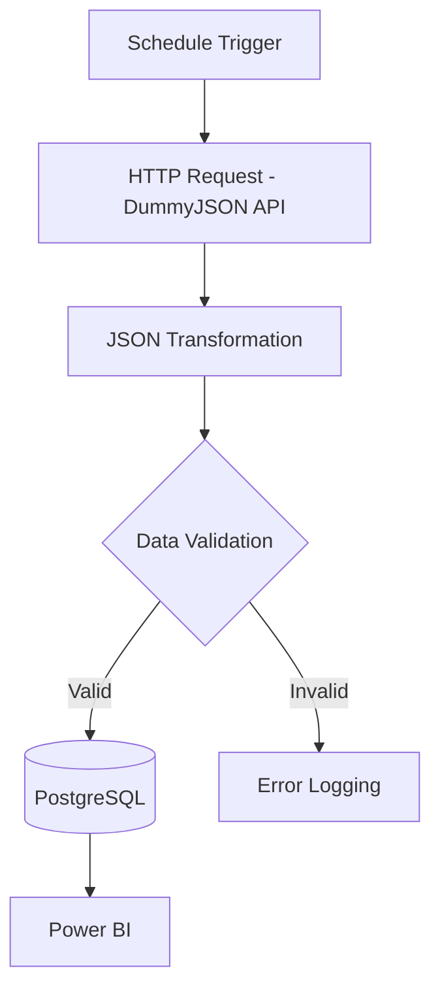

# Automated Sales Reporting Pipeline

## 1. Project Overview

This project aims to develop an automated data pipeline for extracting, transforming, validating, and storing sales-related data using n8n and PostgreSQL.

The objective is to create a reliable data integration process that can support business intelligence reporting in Power BI.

The project is developed incrementally, following data engineering and analytics best practices.

**Current status:** In development — API data extraction completed.

## 2. Business Context

Sales reporting requires reliable and regularly updated data.

Manual data extraction and preparation can be time-consuming and may introduce errors or inconsistencies.

This project explores how workflow automation can improve data collection, data quality, and reporting processes.

The pipeline uses simulated e-commerce cart data to demonstrate a practical sales reporting architecture.

## 3. Technology Stack

| Technology   | Purpose                                   |
| ------------ | ----------------------------------------- |
| n8n          | Workflow orchestration and automation     |
| Docker       | Containerized n8n environment             |
| REST API     | Sales-related data extraction             |
| JSON         | API data exchange format                  |
| PostgreSQL   | Data storage (planned)                    |
| SQL          | Data validation and analysis (planned)    |
| Power BI     | Business intelligence reporting (planned) |
| Git & GitHub | Version control and project documentation |

## 4. Data Source

The project uses the public DummyJSON API.

**Endpoint:**

`https://dummyjson.com/carts`

The API provides simulated e-commerce shopping cart data, including:

- Cart identifiers
- Product identifiers and names
- Product prices
- Quantities
- Discount percentages
- Total amounts

**Note:** The dataset contains fictional shopping carts rather than actual completed sales transactions.

## 5. Pipeline Architecture

The following diagram illustrates the target architecture of the automated sales reporting pipeline.



**Note:** This diagram represents the target architecture. The pipeline is being implemented incrementally.

## 6. Current Implementation

### Phase 1 — API Data Extraction

**Status: Completed**

The first workflow extracts JSON data from the DummyJSON API.

Implemented components:

1. Manual Trigger to initiate the workflow.
2. HTTP Request node configured with the GET method.
3. Connection to the DummyJSON carts endpoint.
4. Successful API response retrieval.

**Current workflow:**

```text
Manual Trigger
      |
      v
HTTP Request
      |
      v
JSON Response
```

The workflow definition is available in:

`workflows/sales_reporting_api_data_extraction.json`

## 7. Development Roadmap

| Phase | Description                           | Status    |
| ----- | ------------------------------------- | --------- |
| 1     | API data extraction                   | Completed |
| 2     | JSON transformation and normalization | Planned   |
| 3     | Data quality validation               | Planned   |
| 4     | PostgreSQL integration                | Planned   |
| 5     | Error handling and logging            | Planned   |
| 6     | Scheduled workflow execution          | Planned   |
| 7     | Power BI reporting                    | Planned   |
| 8     | Final testing and documentation       | Planned   |

## 8. Expected Outcomes

The completed project aims to demonstrate:

- REST API integration using n8n.
- Automated data extraction and transformation.
- Data quality controls.
- PostgreSQL data loading.
- Workflow error handling.
- Scheduled pipeline execution.
- Integration with Power BI.
- Version control and technical documentation.

## 9. Project Status

This project is currently under active development.

The initial API extraction workflow has been implemented and successfully tested.

Additional features will be documented as development progresses.
