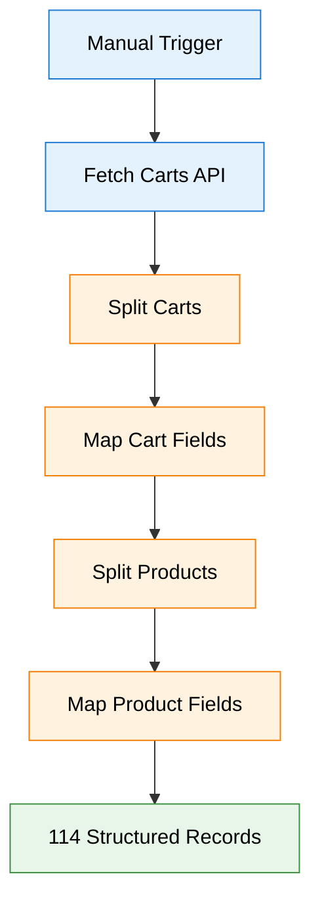
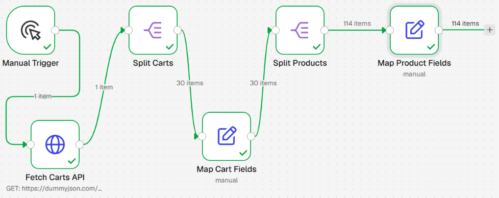
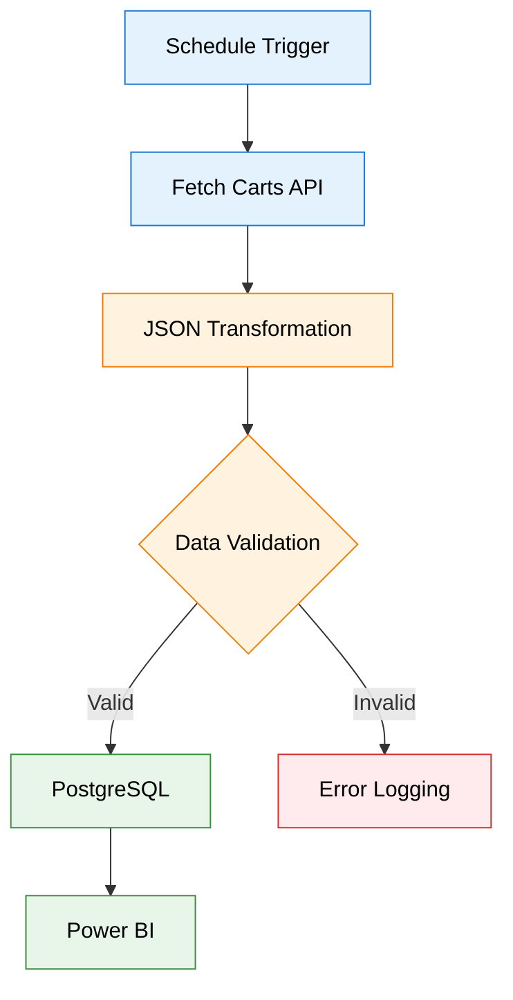

# Automated Sales Reporting Pipeline

### Data Automation | n8n | REST API | JSON | PostgreSQL | Power BI

**Project Status:** 🚧 In Progress — JSON Transformation Completed

## 1. Project Overview

This project aims to develop an automated data pipeline for extracting, transforming, validating, and storing sales-related data.

The pipeline uses **n8n** to orchestrate data extraction from the DummyJSON REST API.

The transformed data will be loaded into PostgreSQL and used to build analytical reports in Power BI.

The project follows an incremental development approach, with each implementation phase documented and version-controlled using Git.

### Business Objectives

- Automate sales-related data extraction.
- Transform nested JSON into structured records.
- Implement data quality validation.
- Prevent duplicate records.
- Store validated data in PostgreSQL.
- Enable business reporting through Power BI.
- Implement workflow monitoring and error handling.

> **Note:** DummyJSON provides simulated shopping cart data. The dataset represents shopping cart contents rather than confirmed sales transactions.

---

## 2. Current Workflow Architecture

The current workflow implements API extraction and JSON transformation.



### Workflow Components

| Node               | Description                                          |
| ------------------ | ---------------------------------------------------- |
| Manual Trigger     | Starts the workflow manually                         |
| Fetch Carts API    | Retrieves shopping cart data from DummyJSON          |
| Split Carts        | Converts the carts array into individual items       |
| Map Cart Fields    | Selects and renames cart-level attributes            |
| Split Products     | Converts nested product arrays into individual items |
| Map Product Fields | Produces structured, flattened records               |

---


### n8n Workflow — Successful Execution

The following screenshot shows the implemented n8n workflow after a successful execution.



**Execution results:**

- 1 API response
- 30 shopping carts extracted
- 114 cart-product records generated
- 11 structured output fields

## 3. Data Source

**Source:** DummyJSON REST API

**Endpoint:** `https://dummyjson.com/carts`

**HTTP Method:** GET

**Authentication:** None

The API provides simulated shopping cart data containing:

- Cart identifiers.
- User identifiers.
- Product identifiers.
- Product descriptions.
- Unit prices.
- Quantities.
- Product totals.
- Discount percentages.
- Discounted totals.

The source data is returned as nested JSON.

---

## 4. Data Transformation

### Transformation Process

The initial API response contains a JSON object with an array of shopping carts.

Each shopping cart contains multiple products.

The workflow performs the following transformations:

**Step 1 — Cart Extraction**

The first Split Out node separates the shopping carts into individual n8n items.

**Step 2 — Cart Field Mapping**

Cart-level fields are selected and renamed to provide consistent column names.

**Step 3 — Product Extraction**

The second Split Out node separates individual products while preserving their associated cart information.

**Step 4 — Product Field Mapping**

The final Edit Fields node extracts product attributes and generates structured records.

### Transformation Results

| Metric                                 |     Result |
| -------------------------------------- | ---------: |
| Initial API response                   | 1 n8n item |
| Extracted shopping carts               |         30 |
| Extracted cart-product records         |        114 |
| Output columns                         |         11 |
| Nested product objects in final output |          0 |

**Data Granularity:** One record represents one product within one shopping cart.

These results correspond to a successful workflow execution during development.

### Output Data Structure

| Column                | Description                         |
| --------------------- | ----------------------------------- |
| cart_id               | Shopping cart identifier            |
| user_id               | User identifier                     |
| product_id            | Product identifier                  |
| product_name          | Product description                 |
| unit_price            | Product unit price                  |
| quantity              | Product quantity                    |
| line_total            | Total amount before discount        |
| discount_percentage   | Product discount percentage         |
| line_discounted_total | Total amount after discount         |
| cart_total            | Total shopping cart amount          |
| cart_discounted_total | Shopping cart amount after discount |

**Important:** Cart-level totals are repeated across product records. They must not be aggregated directly at product-line granularity without accounting for duplicate cart-level values.

---

## 5. Data Quality Validation

**Status:** Planned

The next development phase will introduce data quality controls.

Planned validation rules include:

- Mandatory identifier checks.
- Missing value detection.
- Positive quantity validation.
- Non-negative price validation.
- Financial amount consistency checks.
- Duplicate record detection.

Records that fail validation will be separated from valid records for further investigation.

Financial values will also require appropriate decimal precision handling before database insertion.

---

## 6. Target Architecture

The target pipeline will extend the current workflow with automated execution, data validation, database integration, and reporting.



This architecture represents the intended final implementation and is not yet fully operational.

---


## 7. Technology Stack

| Technology   | Purpose                                           | Status      |
| ------------ | ------------------------------------------------- | ----------- |
| n8n          | Workflow orchestration                            | Implemented |
| Docker       | n8n containerization                              | Implemented |
| REST API     | Data extraction                                   | Implemented |
| JSON         | Source data format                                | Implemented |
| Git / GitHub | Version control                                   | Implemented |
| Mermaid      | Architecture diagrams and technical documentation | Implemented |
| PostgreSQL   | Data storage                                      | Planned     |
| SQL          | Data quality and analytical queries               | Planned     |
| Power BI     | Business reporting                                | Planned     |

---

## 8. Project Structure

```text
n8n-sales-reporting/
│
├── README.md
│
├── workflows/
│   └── sales_reporting_api_data_extraction.json
│
├── sql/
│
├── data/
│
└── assets/
    └── n8n-workflow.png
```

The `assets` directory is intended to contain workflow screenshots and transformation results.

---

## 9. Development Progress

| Phase | Description                        | Status    |
| ----- | ---------------------------------- | --------- |
| 1     | API Data Extraction                | Completed |
| 2     | JSON Transformation and Flattening | Completed |
| 3     | Data Quality Validation            | Planned   |
| 4     | PostgreSQL Integration             | Planned   |
| 5     | Error Handling                     | Planned   |
| 6     | Scheduled Execution                | Planned   |
| 7     | Power BI Reporting                 | Planned   |

The project is developed incrementally, with each major milestone tracked through Git commits.

---

## 10. How to Run

### Prerequisites

- Docker Desktop
- A running n8n instance
- Access to the DummyJSON API

### Import the Workflow

1. Start the n8n instance.
2. Open the n8n editor.
3. Create a new workflow.
4. Import the JSON file from the `workflows/` directory.
5. Review the imported node configurations.
6. Execute the workflow manually.
7. Inspect the output of the `Map Product Fields` node.

The workflow currently requires no API authentication or PostgreSQL credentials.

### Expected Result

The final node should return flattened cart-product records with 11 fields.

The number of records may vary depending on the API response.

---

## 11. Future Improvements

Planned improvements include:

- Automated scheduled execution.
- Data validation and error routing.
- PostgreSQL database integration.
- Duplicate prevention and idempotent loading.
- Workflow monitoring.
- Power BI dashboard integration.
- Additional SQL-based data quality checks.

---

## 12. Key Learning Outcomes

This project demonstrates practical experience with:

- REST API integration.
- Workflow orchestration using n8n.
- Nested JSON processing.
- Data flattening.
- Data granularity definition.
- Data transformation.
- Technical documentation.
- Git-based version control.

The next development phases will extend these capabilities to data quality management, database integration, and automated reporting.
