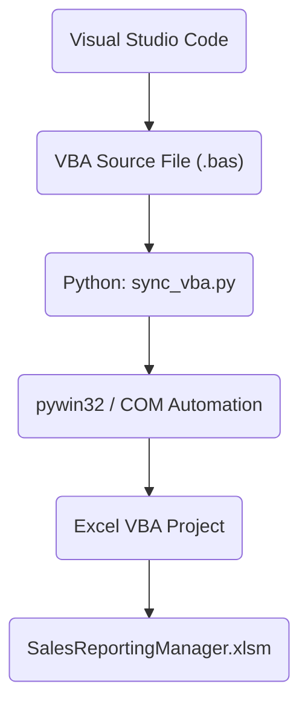
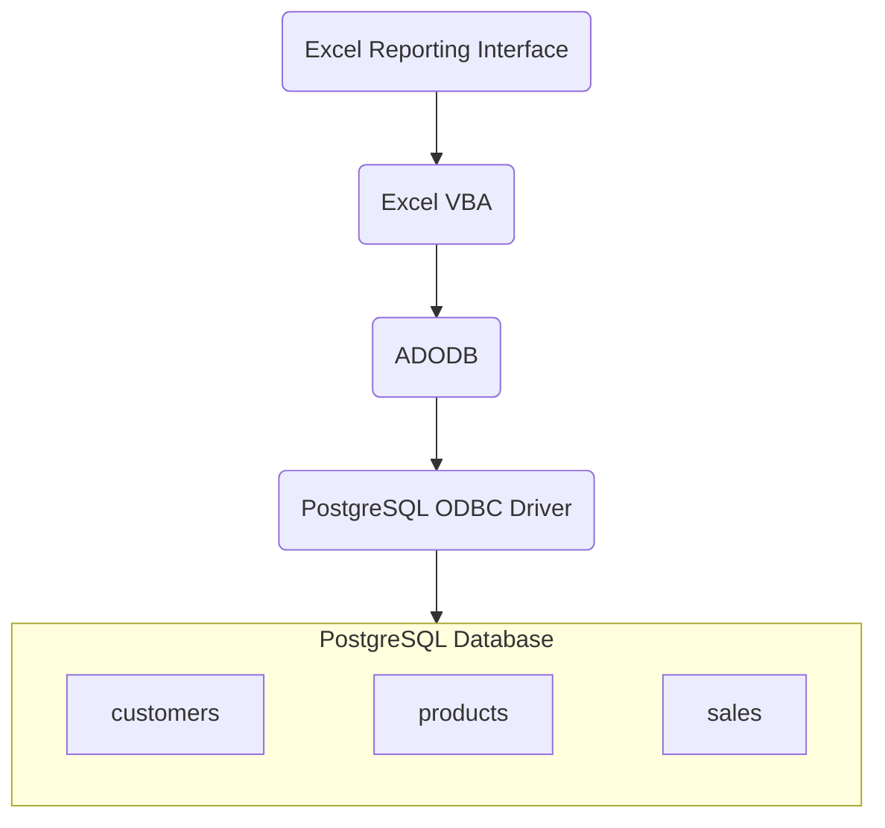

# Sales Reporting Manager

### Excel VBA | Python | PostgreSQL | ADODB | ODBC

## 📌 Project Overview

**Sales Reporting Manager** is an Excel-based reporting application designed to retrieve, process, and analyze sales data stored in a PostgreSQL database.

The project combines Excel VBA, ADODB, ODBC, Python, and SQL to demonstrate database connectivity, object-oriented programming, and workflow automation.

Python is used to automate the deployment of VBA modules developed in Visual Studio Code into an Excel macro-enabled workbook.

The application is currently under development.

## 🎯 Project Objectives

The main objectives are to:

- Build an Excel reporting application connected to PostgreSQL.
- Retrieve and analyze sales data using SQL and ADODB.
- Apply object-oriented programming principles through VBA class modules.
- Automate VBA module deployment using Python and COM automation.
- Develop an interactive Excel reporting interface.
- Maintain a structured and version-controlled development workflow.

## 🛠️ Technologies Used

| Technology         | Purpose                                                 |
| ------------------ | ------------------------------------------------------- |
| Excel VBA          | Application development and reporting                   |
| PostgreSQL         | Relational database                                     |
| SQL                | Data querying and aggregation                           |
| ADODB              | Database connectivity and recordset management          |
| ODBC / psqlODBC    | Communication between ADODB and PostgreSQL              |
| Python             | VBA deployment automation                               |
| pywin32            | Excel COM automation                                    |
| Visual Studio Code | Source code development                                 |
| Git & GitHub       | Version control                                         |
| Mermaid            | System architecture diagrams and workflow visualization |
| dbdiagram.io       | Database schema documentation (planned)                 |

## 🏗️ System Architecture

The project combines two workflows.

### 1. VBA Development and Deployment



**Current implementation:** automatic deployment of a standard VBA module (`.bas`).

Class module (`.cls`) deployment is planned.

### 2. Database Connectivity and Reporting



This architecture represents the target reporting workflow and is not yet fully implemented.

## 🗄️ Database Structure

The PostgreSQL database is named `sales_reporting_db`.

It contains three main tables:

| Table         | Description          |
| ------------- | -------------------- |
| `customers` | Customer information |
| `products`  | Product information  |
| `sales`     | Sales transactions   |

### Sample Dataset

The development database currently contains:

| Entity    | Records |
| --------- | ------: |
| Customers |      10 |
| Products  |      10 |
| Sales     |   1,000 |

The database will support sales analysis and reporting through SQL queries executed from Excel VBA.

A relational database diagram will be added using dbdiagram.io.

## 📁 Project Structure

```text
Sales-Reporting-Manager/
│
├── .gitignore
├── README.md
├── requirements.txt
│
├── src/
│   ├── modules/
│   │   └── modDatabaseTest.bas
│   └── classes/
│
├── scripts/
│   └── sync_vba.py
│
├── workbook/
│   └── SalesReportingManager.xlsm
│
├── sql/
├── docs/
└── assets/
```

*Some directories are reserved for upcoming development stages.*

## ⚙️ Current Features

### Python-to-Excel VBA Synchronization

The `sync_vba.py` script automates the deployment of VBA source code into an Excel workbook.

Current capabilities:

- Detect the project directory automatically.
- Validate the existence of required files.
- Create a timestamped workbook backup.
- Launch an independent Excel instance using COM.
- Access the workbook's VBA project.
- Replace an existing standard VBA module.
- Import a VBA source file.
- Save and close the workbook.

### ADODB Initialization Test

The `modDatabaseTest.bas` module verifies that Excel VBA can instantiate an ADODB connection object.

The test has been successfully executed in Excel.

**Note:** This test validates ADODB object creation only. PostgreSQL connectivity has not yet been implemented.

## 🚀 Getting Started

### Prerequisites

- Windows
- Microsoft Excel with VBA support
- Python
- PostgreSQL
- PostgreSQL ODBC driver
- Visual Studio Code (recommended)

### 1. Create a Python Virtual Environment

From the project directory:

```powershell
python -m venv .venv
```

Activate the environment:

```powershell
.\.venv\Scripts\Activate.ps1
```

### 2. Install Python Dependencies

```powershell
python -m pip install -r requirements.txt
```

### 3. Configure Excel

Open Excel and enable:

**File → Options → Trust Center → Trust Center Settings → Macro Settings → Trust access to the VBA project object model**

Enable this setting only in a trusted development environment.

### 4. Run the VBA Synchronization Script

Close `SalesReportingManager.xlsm` before executing the script.

```powershell
python scripts/sync_vba.py
```

Expected output:

```text
Sauvegarde créée : SalesReportingManager_YYYYMMDD_HHMMSS.xlsm
Synchronisation VBA réussie !
```

### 5. Verify the VBA Module

Open `SalesReportingManager.xlsm`.

Press `Alt + F11` to access the VBA editor.

Locate the module:

`modDatabaseTest`

Execute:

`Test_ADODB`

A confirmation message should appear if the ADODB object is successfully created.

## 🔐 Security Considerations

- Database credentials must not be committed to GitHub.
- Python virtual environments are excluded from version control.
- Local workbook backups are excluded from version control.
- VBA project access should only be enabled in trusted environments.
- Database connection settings will be externalized during future development.

## 📈 Development Roadmap

| Phase | Description                            | Status                    |
| ----- | -------------------------------------- | ------------------------- |
| 1     | PostgreSQL database setup              | ✅ Completed locally      |
| 2     | Python and VBA development environment | ✅ Completed              |
| 3     | Python-to-Excel VBA synchronization    | ✅ Completed for `.bas` |
| 4     | VBA source encoding improvements       | 🔄 Planned                |
| 5     | VBA class module deployment            | 🔄 Planned                |
| 6     | ADODB/ODBC PostgreSQL connection       | 🔄 Planned                |
| 7     | SQL data retrieval and processing      | 🔄 Planned                |
| 8     | Excel reporting dashboard              | 🔄 Planned                |
| 9     | Database diagram and documentation     | 🔄 Planned                |

## 🎓 Skills Demonstrated

This project aims to demonstrate practical skills in:

- Excel VBA development
- Python automation
- COM automation
- Relational database design
- PostgreSQL and SQL
- ADODB and ODBC integration
- Object-oriented programming
- Git-based development workflows
- Reporting application development

## 📌 Project Status

**Status: In Development**

The first development milestone has been completed: VBA source code written in Visual Studio Code can be automatically imported into an Excel workbook using Python.

The next milestone focuses on improving the synchronization process and implementing reusable VBA classes for PostgreSQL database connectivity.
